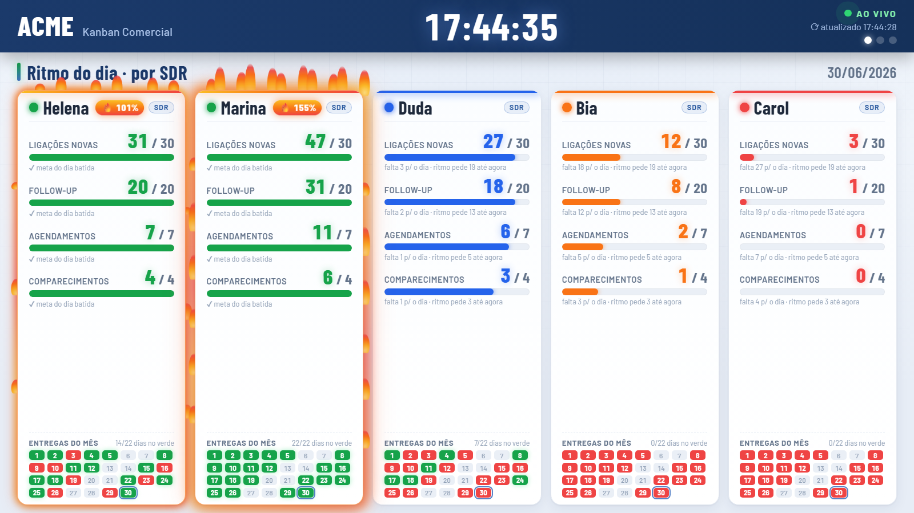

# Sales Kanban — Painel de TV

Painel de TV ao vivo do ritmo comercial: **SDRs e closers hora a hora** contra meta, com
semáforo (verde/laranja/vermelho), ranking do mês e celebração quando bate a meta (balões + fogo).
Arquivo **único e autocontido** — clique duplo, sem servidor. **Dados 100% fictícios.**

🔗 **Demo ao vivo:** https://jeanfelipecr-ds.github.io/sales-kanban-dashboard/

- **3 telas em rotação**: SDR · Closer · Mês (funil, faturamento e ranking).
- **Tema claro/escuro** (tecla `T`), réguas de entregas do mês, anéis de score.
- Paleta de status verde/laranja/vermelho — **sem dependências externas** (só CSS/JS puro).

Parte do portfólio de **Jean Felipe Carneiro** — Analista de Dados & BI · [jeanfelipecr-ds.github.io](https://jeanfelipecr-ds.github.io)

🇬🇧 <b>English</b>

 

# Sales Kanban — TV Dashboard

A live TV board for the sales floor: **reps and closers tracked hour-by-hour** against pro-rated
targets, with a traffic-light system, monthly ranking and a celebration when a goal is hit
(balloons + fire). A **single self-contained file** — double-click, no server. **100% synthetic data.**

🔗 **Live demo:** https://jeanfelipecr-ds.github.io/sales-kanban-dashboard/

- **3 rotating screens**: SDR · Closer · Month (funnel, revenue and ranking).
- **Light/dark theme** (press `T`), monthly delivery rulers, score rings.
- Status palette green/orange/red — **no external dependencies** (pure CSS/JS).

Part of the portfolio of **Jean Felipe Carneiro** — Data Analyst & BI · [jeanfelipecr-ds.github.io](https://jeanfelipecr-ds.github.io)

